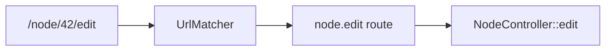

# Routing

The **Routing** component maps URL paths to controllers (or other callables) with HTTP method constraints, parameter requirements, and default values. Drupal stores routes in YAML files and can alter them at runtime via route subscribers.

## Core concepts

| Concept | Description |
|---------|-------------|
| Route | A path pattern, defaults, requirements, and options |
| RouteCollection | All routes merged from core and modules |
| RouteProvider | Loads and caches the collection |
| Parameter conversion | Turns `{node}` in the URL into a loaded entity object |



## How Drupal uses routing

### Static routes in `*.routing.yml`

Every module can define routes. Drupal compiles them into a cached `RouteCollection`:

```yaml
# my_module.routing.yml
my_module.product_list:
  path: '/admin/products'
  defaults:
    _controller: '\Drupal\my_module\Controller\ProductController::list'
    _title: 'Products'
  requirements:
    _permission: 'administer my_module'

my_module.product_view:
  path: '/product/{product}'
  defaults:
    _controller: '\Drupal\my_module\Controller\ProductController::view'
    _title_callback: '\Drupal\my_module\Controller\ProductController::title'
  requirements:
    _entity_access: 'product.view'
    product: \d+
  options:
    parameters:
      product:
        type: 'entity:product'
```

### Dynamic routes via `RouteSubscriber`

Some routes are generated at compile time based on configuration or entity definitions:

```php
<?php

declare(strict_types=1);

namespace Drupal\my_module\Routing;

use Drupal\Core\DependencyInjection\ContainerInjectionInterface;
use Symfony\Component\DependencyInjection\ContainerInterface;
use Symfony\Component\Routing\Route;
use Symfony\Component\Routing\RouteCollection;

final class ProductRoutes implements ContainerInjectionInterface {

  public function __construct(
    private readonly \Drupal\Core\Entity\EntityTypeManagerInterface $entityTypeManager,
  ) {}

  public static function create(ContainerInterface $container): static {
    return new static(
      $container->get('entity_type.manager'),
    );
  }

  public function routes(): RouteCollection {
    $collection = new RouteCollection();

    foreach ($this->entityTypeManager->getStorage('product_type')->loadMultiple() as $type) {
      $id = $type->id();
      $collection->add("my_module.product_type.{$id}", new Route(
        "/products/{$id}",
        [
          '_controller' => '\Drupal\my_module\Controller\ProductController::byType',
          'product_type' => $id,
        ],
        ['_permission' => 'access content'],
      ));
    }

    return $collection;
  }

}
```

Register the subscriber in services:

```yaml
# my_module.services.yml
services:
  my_module.route_subscriber:
    class: Drupal\my_module\Routing\ProductRouteSubscriber
    tags:
      - { name: event_subscriber }
```

```php
<?php

declare(strict_types=1);

namespace Drupal\my_module\Routing;

use Drupal\Core\Routing\RouteSubscriberBase;
use Symfony\Component\Routing\RouteCollection;

final class ProductRouteSubscriber extends RouteSubscriberBase {

  protected function alterRoutes(RouteCollection $collection): void {
    if ($route = $collection->get('my_module.product_list')) {
      $route->setRequirement('_custom_access', '\Drupal\my_module\Access\ProductAccessCheck::checkAccess');
    }
  }

}
```

## Route subscribers vs event subscribers

=== "RouteSubscriber (alter routes)"

    ```php
    <?php

    declare(strict_types=1);

    namespace Drupal\my_module\Routing;

    use Drupal\Core\Routing\RouteSubscriberBase;
    use Symfony\Component\Routing\RouteCollection;

    final class AdminRouteSubscriber extends RouteSubscriberBase {

      protected function alterRoutes(RouteCollection $collection): void {
        // Change the path of an existing core route.
        if ($route = $collection->get('system.admin')) {
          $route->setPath('/dashboard');
        }
      }

    }
    ```

=== "Event subscriber (runtime)"

    ```php
    <?php

    declare(strict_types=1);

    namespace Drupal\my_module\EventSubscriber;

    use Symfony\Component\EventDispatcher\EventSubscriberInterface;
    use Symfony\Component\HttpKernel\Event\RequestEvent;
    use Symfony\Component\HttpKernel\KernelEvents;

    final class ApiVersionSubscriber implements EventSubscriberInterface {

      public static function getSubscribedEvents(): array {
        return [KernelEvents::REQUEST => ['onRequest', 30]];
      }

      public function onRequest(RequestEvent $event): void {
        $request = $event->getRequest();
        if (str_starts_with($request->getPathInfo(), '/api/v2')) {
          $request->attributes->set('api_version', 2);
        }
      }

    }
    ```

## Access control on routes

Routes use `_permission`, `_role`, `_entity_access`, `_custom_access`, or `_access` requirements:

```yaml
my_module.product_delete:
  path: '/admin/products/{product}/delete'
  defaults:
    _entity_form: 'product.delete'
  requirements:
    _entity_access: 'product.delete'
    _csrf_token: 'TRUE'
```

Custom access check:

```php
<?php

declare(strict_types=1);

namespace Drupal\my_module\Access;

use Drupal\Core\Access\AccessResult;
use Drupal\Core\Routing\Access\AccessInterface;
use Drupal\Core\Session\AccountInterface;
use Drupal\my_module\Entity\Product;

final class ProductAccessCheck implements AccessInterface {

  public function checkAccess(AccountInterface $account, Product $product): AccessResult {
    if ($product->getOwnerId() === (int) $account->id()) {
      return AccessResult::allowed()->cachePerUser();
    }
    return AccessResult::forbidden()->cachePerPermissions();
  }

}
```

```yaml
# my_module.services.yml
services:
  my_module.product_access:
    class: Drupal\my_module\Access\ProductAccessCheck
    tags:
      - { name: access_check, applies_to: _product_owner }
```

## Custom module example: REST-style resource routes

=== "routing.yml"

    ```yaml
    my_module.api.products:
      path: '/api/products'
      defaults:
        _controller: '\Drupal\my_module\Controller\ProductApiController::collection'
      requirements:
        _permission: 'access content'
      methods: [GET]

    my_module.api.product:
      path: '/api/products/{product}'
      defaults:
        _controller: '\Drupal\my_module\Controller\ProductApiController::item'
      requirements:
        _entity_access: 'product.view'
        product: \d+
      methods: [GET]
      options:
        parameters:
          product:
            type: 'entity:product'
    ```

=== "Controller"

    ```php
    <?php

    declare(strict_types=1);

    namespace Drupal\my_module\Controller;

    use Drupal\Core\Controller\ControllerBase;
    use Drupal\my_module\Entity\Product;
    use Symfony\Component\HttpFoundation\JsonResponse;

    final class ProductApiController extends ControllerBase {

      public function collection(): JsonResponse {
        $storage = $this->entityTypeManager()->getStorage('product');
        $ids = $storage->getQuery()->accessCheck(TRUE)->execute();
        $products = $storage->loadMultiple($ids);

        $data = array_map(fn (Product $p) => [
          'id' => $p->id(),
          'title' => $p->label(),
        ], $products);

        return new JsonResponse(['data' => array_values($data)]);
      }

      public function item(Product $product): JsonResponse {
        return new JsonResponse([
          'id' => $product->id(),
          'title' => $product->label(),
          'price' => $product->get('price')->value,
        ]);
      }

    }
    ```

!!! warning "Rebuild routes after changes"
    Route definitions are cached. After adding or changing `*.routing.yml`, run `drush cr` or visit `/admin/config/development/performance` and clear caches.

## Related reading

- [Controllers](controllers.md)
- [Internals: Routing](../internals/routing.md)
- [Access & Permissions](../custom-coding/access-permissions.md)
